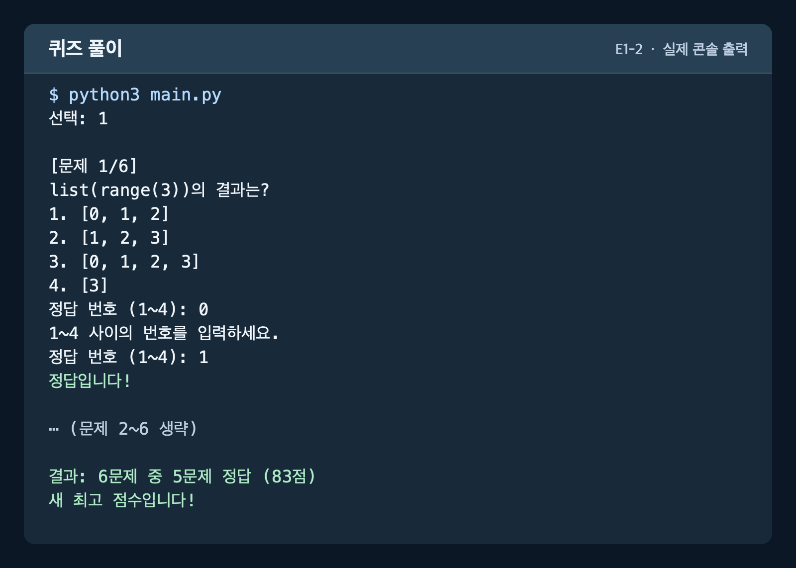

# 파이썬 기초 퀴즈

## 프로젝트 개요

터미널에서 파이썬 기초 문제를 풀고 직접 문제를 등록하는 콘솔 게임입니다. 등록한 문제와 최고 점수는 종료 후에도 유지됩니다.

[실행 화면과 로그](#제출-증빙) · [저장 및 복구](#저장-데이터) · [대규모 데이터 분석](docs/performance.md) · [커밋 작성 방법](CONTRIBUTING.md)

## 퀴즈 주제와 선정 이유

파이썬의 자료형, 반복 범위, 예외, 인스턴스 메서드를 주제로 골랐습니다. 게임을 만드는 데 사용한 개념을 문제로 다시 확인하고, 짧은 예제의 실행 결과를 직접 예측해 볼 수 있기 때문입니다.

## 실행 방법

Python 3.10 이상이 필요합니다. 외부 패키지는 필요하지 않습니다.

```sh
git clone https://github.com/javapv1887/e1-2-quiz-game.git
cd e1-2-quiz-game
python3 main.py
```

이미 내려받은 경우 프로젝트 폴더에서 `python3 main.py`만 실행하면 됩니다.

## 기능 목록

| 메뉴 | 동작 |
| --- | --- |
| 1. 퀴즈 풀기 | 게임을 시작할 때마다 문제 순서를 섞어 등록된 모든 문제를 한 번씩 출제합니다. 문제마다 정오답을 확인하고 마지막에 점수를 표시합니다. |
| 2. 퀴즈 추가 | 문제, 선택지 4개, 정답 번호를 받아 저장합니다. |
| 3. 퀴즈 목록 | 등록된 문제의 제목과 개수를 확인합니다. |
| 4. 점수 확인 | 최고 점수와 해당 게임의 정답 수, 전체 문제 수를 확인합니다. |
| 5. 종료 | 게임을 종료합니다. Ctrl+C 또는 입력 스트림 종료도 처리합니다. |

번호 입력은 앞뒤 공백을 제거하고, 빈 입력·정수가 아닌 입력·범위를 벗어난 입력을 다시 받습니다. 점수는 정답률을 100점 만점의 정수로 내림해 표시합니다. 최고 기록 갱신에는 내림 전 정답률을 비교하고, 같은 정답률이면 먼저 세운 기록을 유지합니다.

| 잘못된 입력 | 안내 메시지 |
| --- | --- |
| 메뉴에서 Enter만 누름 | `번호를 입력하세요.` |
| 메뉴에 `abc` 입력 | `정수를 입력하세요.` |
| 메뉴에 `9` 입력 | `1~5 사이의 번호를 입력하세요.` |
| 정답 번호에 `0` 입력 | `1~4 사이의 번호를 입력하세요.` |
| 문제나 선택지를 비워 둠 | `내용을 입력하세요.` |

기본 문제 예시로 `len([10, 20, 30])의 결과는?`가 있습니다. 선택지는 1번 `2`, 2번 `3`, 3번 `10`, 4번 `30`이며, 정답은 2번입니다.

출제할 때는 퀴즈 목록의 복사본을 표준 라이브러리의 `random.shuffle()`로 섞습니다. 퀴즈 목록 화면과 저장 파일은 등록 순서를 유지합니다.

메뉴에서 5번을 선택하거나 Ctrl+C 또는 EOF로 종료하면 남은 저장 작업을 시도합니다. 운영 환경에서 SIGTERM도 처리해야 한다면 시그널 처리기에서는 종료 요청만 표시하고, 게임의 종료 경로로 돌아가 저장하도록 확장할 수 있습니다. 현재 SIGTERM은 운영체제의 기본 동작을 따릅니다.

## 파일 구조

| 경로 | 역할 |
| --- | --- |
| `main.py` | 프로그램 실행 |
| `quiz.py` | 개별 문제 표현, 출력, 채점, JSON 항목 변환 |
| `quiz_game.py` | 콘솔 메뉴, 입력 처리, 게임 진행, 점수 관리, 저장·복구 흐름 |
| `storage.py` | JSON 검증, 정상 버전 백업, 안전한 파일 교체 |
| `default_quizzes.py` | 기본 퀴즈 5개 |
| `state.json` | 실행 시 생성되는 개인 퀴즈와 최고 점수 데이터 |
| `state.json.bak` | 직전에 검증된 정상 저장본 한 세대 |
| `state.json.corrupt-*` | 복구 직전에 보존한 손상 파일 |
| `docs/screenshots/`, `docs/logs/` | 개발 환경, 프로그램 실행, Git 실습 증빙 |
| `.gitignore` | 개인 저장 데이터, 백업, 손상본, 파이썬 캐시를 Git에서 제외 |

`Quiz`는 한 문제의 질문·선택지·정답을 함께 관리합니다. 기본 문제, 사용자가 추가한 문제, JSON에서 읽은 문제가 같은 생성자 검증과 `is_correct()`를 재사용합니다. `QuizGame`은 여러 문제와 최고 점수, 메뉴 흐름을 하나의 세션으로 묶습니다. 예를 들어 `play()`는 각 문제를 `Quiz.show()`로 출력하고 채점한 뒤 그 세션의 최고 점수를 갱신합니다.

| 변경할 요구사항 | 확인할 파일과 함수·메서드 |
| --- | --- |
| 메뉴, 입력 메시지, 입력 범위 | `quiz_game.py`의 `run()`, `show_menu()`, `read_number()`, `read_text()` |
| 출제 순서, 문제 수, 점수 | `quiz_game.py`의 `play()`, `update_best_score()`, `show_best_score()` |
| 기본 문제·선택지·정답 형식 | `default_quizzes.py`의 `make_default_quizzes()`, `quiz.py`의 `Quiz`, `quiz_game.py`의 `add_quiz()` |
| 저장 경로, 스키마, 백업 | `quiz_game.py`의 `load_state()`, `save_state()`, `storage.py`의 `read_state()`, `write_state()`, `quiz.py`의 `to_record()`, `from_record()`, `.gitignore` |

## 저장 데이터

실행한 디렉터리와 관계없이 프로젝트 루트의 `state.json`을 UTF-8로 읽고 씁니다.

| 필드 | 구조 |
| --- | --- |
| `quizzes` | 문제 객체의 배열. 각 객체는 `question`(문자열), `choices`(문자열 4개의 배열), `answer`(1–4 사이의 정수)를 가집니다. |
| `best_score` | 게임을 마친 기록이 없으면 `null`. 기록이 있으면 `correct`(정답 수)와 `total`(전체 문제 수)을 담은 객체입니다. |

```json
{
  "quizzes": [
    {
      "question": "len([10, 20, 30])의 결과는?",
      "choices": ["2", "3", "10", "30"],
      "answer": 2
    }
  ],
  "best_score": {"correct": 1, "total": 1}
}
```

| 상황 | 동작 |
| --- | --- |
| 첫 실행 | 저장본과 백업이 없으면 기본 퀴즈 5개와 빈 최고 기록으로 시작하고, 종료할 때 파일을 생성합니다. |
| 퀴즈 추가·최고 점수 갱신 | 현재 JSON을 검증해 `state.json.bak`에 한 세대 보관한 후, 임시 파일로 완성한 새 JSON을 `state.json`에 반영합니다. |
| 저장본 누락·손상 | 정상 백업이 있으면 퀴즈와 점수를 복구합니다. 백업도 없거나 손상됐으면 기본 퀴즈로 시작합니다. 복구 내용을 저장할 때 손상된 원본은 `state.json.corrupt-*`에 복사합니다. |
| 쓰기 실패 | `save_state()`에서 콘솔에 오류를 출력하고, 종료 시 `run()`의 `finally`에서 안내와 함께 저장을 다시 시도합니다. |

권한 오류가 나면 프로젝트 폴더에서 `ls -ld . state.json state.json.bak`로 소유자와 권한을 확인하세요. 파일을 읽을 수 없으면 그 실행에서는 저장을 건너뜁니다. 읽기 오류는 소유자에게 파일 읽기 권한과 폴더 접근 권한을 받아 프로그램을 다시 실행하세요. 쓰기 오류는 폴더의 쓰기·접근 권한을 확인한 뒤 게임에서 5번으로 종료해 다시 저장을 시도하세요. 읽기 전용 위치라면 기존 저장본과 정상 백업을 쓰기 가능한 프로젝트 복사본으로 옮겨 실행합니다.

수동 복구가 필요하면 게임을 종료하고 `state.json`과 백업을 별도 위치에 복사하세요. 정상 백업의 퀴즈와 점수를 확인하고 `state.json`으로 복사한 뒤 다시 실행하세요. 백업은 직전 버전이므로 가장 최근에 추가한 문제나 점수는 빠질 수 있습니다. 장기 보존이 필요하면 정상 저장본을 날짜별로 별도 위치에 복사해 두세요.

## 제출 증빙



| 확인 항목 | 증빙 |
| --- | --- |
| 개발 환경 | [Python·Git 설정](docs/screenshots/environment.png) |
| 메뉴와 게임 실행 | [메뉴](docs/screenshots/menu.png) · [추가](docs/screenshots/add_quiz.png) · [목록](docs/screenshots/list_quizzes.png) · [풀이](docs/screenshots/play.png) · [재실행 후 점수](docs/screenshots/score.png) · [전체 콘솔 로그](docs/logs/game.txt) |
| 커밋과 병합 | [Git 그래프 PNG](docs/screenshots/git_log.png) · [커밋 해시와 병합 로그](docs/logs/git_graph.txt) |
| 복제·푸시·풀 | [clone PNG](docs/screenshots/git_clone.png) · [push·pull PNG](docs/screenshots/git_pull.png) · [clone 로그](docs/logs/git_clone.txt) · [push·pull 로그](docs/logs/git_pull.txt) |
| 자동 복구 | [저장본 손상과 정상 백업 복구 로그](docs/logs/recovery.txt) |

PNG는 실제 콘솔 출력을 이미지로 옮긴 것입니다. 전체 게임 로그에는 메뉴 선택, 입력 오류, 퀴즈 등록, 섞인 순서로 진행한 6문제 풀이, 재실행 후 점수 확인을 담았습니다.

퀴즈 풀이 기능은 `codex/play-quiz` 브랜치에서 개발한 뒤 병합 커밋 [`b9c5fda`](https://github.com/javapv1887/e1-2-quiz-game/commit/b9c5fda)로 `main`에 합쳤습니다. 피드백 반영 때 GitHub 저장소를 별도 폴더에 복제해 `CONTRIBUTING.md`를 커밋·푸시하고, 원본에서 `git pull --ff-only origin main`으로 같은 커밋을 받았습니다.
